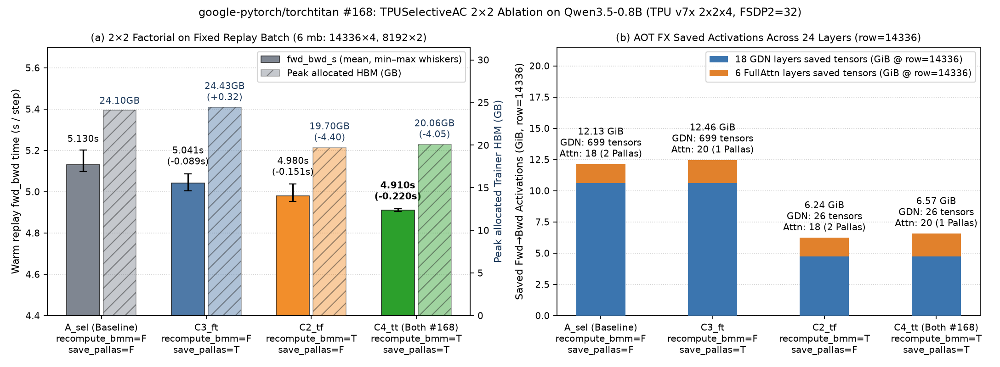
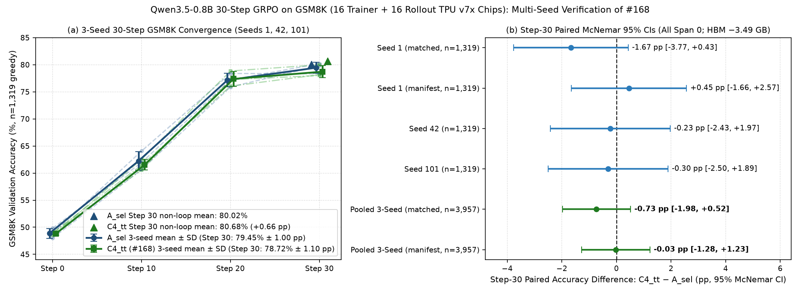

# torchtitan #168: review and benchmark evidence (`TPUSelectiveAC` `recompute_bmm` and `save_pallas_attention`)

[Upstream pull request](https://github.com/google-pytorch/torchtitan/pull/168) · reviewed head `fac85b8bd1e3` on base `cfbb77688269`

We tested both flags of `TPUSelectiveAC` on TPU v7x with Qwen3.5-0.8B GRPO training (16 trainer + 16 rollout chips): a 2×2 fixed-batch replay with XProf and AOT FX / XLA HLO inspection, and a 3-seed (1, 42, 101) 30-step GSM8K run.

**Summary.**

- Both flags behave as described and compose.
- With both on (`C4_tt`), the replay `fwd_bwd` drops from 5.130 s to 4.910 s (−4.3%), and peak trainer HBM drops by 4.05 GB (−16.8%).
- In end-to-end training, peak HBM drops by 3.49 GB (−14.9%). The step time change (−0.29 s) is smaller than the run-to-run SD.
- `save_pallas_attention` alone stays within the replay's run-to-run noise floor.
- `recompute_bmm` gives a small, reproducible numerical difference in one training step (see §2.1).
- Over 3 seeds × 30 steps we detected no accuracy difference (pooled step-30 difference −0.73 pp, 95% CI [−1.98, +0.52]). This does not prove equivalence.

---

## 1. Setup

Recipe values and versions are in [`summaries/run_setup.json`](summaries/run_setup.json).

- **Hardware.** 32 TPU v7x chips per run:
  - 16 trainer chips (4 hosts, one `2x2x4` slice, 32 devices; TP = CP = 1, so FSDP2 over 32 ranks);
  - 16 rollout chips (4 hosts, 16 vLLM engines with TP=2).
  - All replay arms ran on the same trainer hosts (`tpu_worker_hostnames` in `summaries/rank0_warm_timings_*.json`). The 30-step runs each ran on their own hosts (`trainer_nodes` in `summaries/multiseed_comparison.json`).
- **Model and workload.**
  - Model: `Qwen/Qwen3.5-0.8B` at revision `2fc06364`, text-only (18 Gated DeltaNet (GDN) layers and 6 full-attention layers with Pallas splash attention, per the model's Hugging Face config). `model_kernels=none`, i.e. the XLA GDN path.
  - Data: GSM8K, 128 prompts × 16 rollouts per step, max prompt / response 256 / 4,096 tokens, `lr=2.5e-6` with 10 warmup steps.
  - Plugin base includes fixed-shape micro-batch rows (8192 / 14336 / 16384, plugin #130) and per-block `torch.compile` (plugin #131).
- **Software.** Python 3.12.12, torch 2.13.0+cpu, torch_tpu 0.2.0, libtpu 0.0.50, jax 0.12.0.1, vllm 0.32.0.
- **TorchTitan version.** TorchTitan `aaf742e4`, where `TPUSelectiveAC` lives at `torchtitan/experiments/tpu/activation_checkpoint.py`.
  - The file from this PR ([`patches/activation_checkpoint_pr168.py`](patches/activation_checkpoint_pr168.py), SHA-256 `3d4fd13f…`, diff in [`patches/torchtitan-pr168-activation-checkpoint.diff`](patches/torchtitan-pr168-activation-checkpoint.diff)) was installed at that path and at the PR's `components/` path.
  - The plugin was patched to import `TPUSelectiveAC` from either path (failing if it resolves to core `SelectiveAC`) and to pass the two flags into `TPUSelectiveAC.Config`.
  - Each run logged the resolved policy at startup: config class, `recompute_bmm`, `save_pallas_attention`, and whether `aten.bmm` / splash are in the save set (`ac_audit` in `summaries/rank0_warm_timings_*.json`, `ac_audit_line` in `summaries/multiseed_comparison.json`).
- **GDN loop version.** In `aaf742e4`, `torchtitan/experiments/tpu/qwen3_5/gated_delta.py` runs the chunk loop in `_inter_chunk_recurrence` (L236–L240) on chunks split by one `unbind` before the loop. On `main` the loop is inlined in `chunked_gated_delta` and indexes each chunk inside the loop. The saved-tensor and `bmm` counts below are from `aaf742e4`; we did not measure them on `main`. This matches the caveat in the PR description.

## 2. Fixed-batch 2×2 replay

- **Batch.** One real step-1 GRPO batch (2,328,294 valid tokens over 32 ranks, SHA-256 `e3d67e4f…`), frozen.
- **Micro-batch layout.** Locked to `[14336, 14336, 14336, 14336, 8192, 8192]`.
- **Procedure.** Each arm ran 1 compile step, then 5 timed iterations with the profiler off, then 1 iteration with XProf and FX / HLO dumps.

Data: [`summaries/stage1_replay_comparison.json`](summaries/stage1_replay_comparison.json), [`summaries/ab_compile_token_summary.json`](summaries/ab_compile_token_summary.json), [`summaries/aot_graph_stats.json`](summaries/aot_graph_stats.json), [`summaries/hlo_fx_comparison_14336.json`](summaries/hlo_fx_comparison_14336.json), [`summaries/xprof_7cat_comparison.json`](summaries/xprof_7cat_comparison.json), [`summaries/rank0_warm_timings_*.json`](summaries/).

Saved-tensor and splash counts are from the AOT FX graphs at row 14336. "Splash calls in backward" counts Pallas splash kernels in the full-attention backward graph (forward kernel re-run + backward kernel).

| Arm | `recompute_bmm` | `save_pallas_attention` | GDN saved tensors / layer | Full-attn saved tensors / layer | Splash calls in backward | `fwd_bwd` mean (s) | vs. `A_sel` | Peak HBM (GB) | `pg_loss` / `grad_norm` |
|---|:---:|:---:|---:|---:|---:|---:|---:|---:|---:|
| `A_sel` (baseline) | F | F | 699 (604.74 MiB) | 18 (256.42 MiB) | 2 | 5.1302 | — | 24.10 | 0.090924 / 0.333176 |
| `C3_ft` | F | **T** | 699 (604.74 MiB) | **20 (312.86 MiB)** | **1** | 5.0412 | −0.089 s (−1.7%) | 24.43 (+0.32) | 0.090924 / 0.333170 |
| `C2_tf` | **T** | F | **26 (269.24 MiB)** | 18 (256.42 MiB) | 2 | 4.9796 | −0.151 s (−2.9%) | **19.70 (−4.40)** | 0.090961 / 0.332724 |
| **`C4_tt`** | **T** | **T** | **26 (269.24 MiB)** | **20 (312.86 MiB)** | **1** | **4.9099** | **−0.220 s (−4.3%)** | **20.06 (−4.05)** | 0.090961 / 0.332724 |

All four arms ran 836 XLA modules per step. `fwd_bwd` is the mean of timed iterations 2–5 on rank 0 (iteration 1 excluded); peak HBM is the largest `max_memory_allocated` on rank 0 over the timed iterations. At row 8192 the GDN saved tensors per layer are 411 without and 26 with `recompute_bmm`.



*Left: replay `fwd_bwd` (bar: mean of iterations 2–5; whiskers: min–max over all 5 timed iterations, rank 0) and peak HBM. Right: saved activations per GDN and full-attention layer at row 14,336.*

### 2.1 Numerics against the run-to-run noise floor

Data: [`summaries/noise_floor_comparison.json`](summaries/noise_floor_comparison.json). ΔW is the parameter update of one optimizer step on the frozen batch.

| Comparison | `pg_loss` abs diff | `grad_norm` rel diff | ΔW cosine | ΔW sign agreement | ΔW max abs diff |
|---|---:|---:|---:|---:|---:|
| `A_sel` vs. `A_sel` repeat, same slice | 0 | 7.16e-6 | 0.999938 | 99.97% | 2.89e-7 |
| `C4_tt` vs. `C4_tt` repeats | 0 | 0 | 1.000000 | 100.00% | 0 |
| `A_sel` vs. `C3_ft` (`save_pallas_attention` alone) | 0 | 1.79e-5 | 0.999960 | 99.98% | 3.20e-7 |
| `C2_tf` vs. `C4_tt` (`save_pallas_attention` on top of `recompute_bmm`) | 0 | 0 | 1.000000 | 100.00% | 0 |
| `A_sel` vs. `C4_tt`, same slice, two pairs | 3.72e-5 | 1.35e-3 – 1.36e-3 | 0.988937 – 0.988949 | 99.20% – 99.21% | 4.99e-7 |

- **`save_pallas_attention`.** `A_sel` vs. `C3_ft` is within the `A_sel` repeat floor (0.999960 vs. 0.999938), and adding it to `recompute_bmm` changes nothing bit-for-bit.
- **`recompute_bmm`.** It changes the single-step result by more than the noise floor (ΔW cosine 0.9889). The change is reproducible: `C4_tt` repeats are bit-identical.
  - The likely reason is the one in the PR description: recomputed ops are compiled into the backward program, where XLA fuses them differently (GDN backward HLO fusions at row 14336 go from 2,286 to 2,833).
  - We did not isolate which fusion changes the values.
  - The replay harness's tight equivalence check (`pass_criteria` in `stage1_replay_comparison.json`: `pg_loss` diff ≤ 1e-4, `grad_norm` rel diff ≤ 1e-3, ΔW cosine ≥ 0.9999) passes for `C3_ft` and fails for `C2_tf` / `C4_tt`, on `grad_norm` (1.36e-3) and ΔW cosine (0.9889).
  - The multi-seed run in §3 checks whether this matters for training.

### 2.2 Where the time and memory go

- **`recompute_bmm`.** It removes `aten.bmm.default` from the save set.
  - In `aaf742e4`'s GDN chunk loop (row 14336) the forward runs 673 small `bmm` per layer, and selective AC saved each output.
  - Recomputing them cuts saved tensors per GDN layer from 699 (604.74 MiB) to 26 (269.24 MiB), about 5.9 GiB less across 18 layers.
  - This matches the PR's `27 + 3 * seq_len / 64` formula at 14,336 tokens (699), and at 8,192 tokens (411).
- **`save_pallas_attention`.** It wraps the save set in the by-name splash-attention matcher (as in `AttentionSavingSelectiveAC`), so the splash forward output and logsumexp are saved (+56.44 MiB per full-attention layer).
  - Backward no longer re-runs the forward kernel: the full-attention backward graph goes from one splash forward + one splash backward call to only the backward call (`summaries/aot_graph_stats.json`).
  - XProf full-attention backward time drops from 0.4982 s to 0.4276 s (−0.0706 s in `C3_ft`, −0.0715 s in `C4_tt`), consistent with the −0.089 s replay gain.

## 3. Multi-seed 30-step GSM8K

`A_sel` vs. `C4_tt`, seeds 1 / 42 / 101, full 1,319-prompt greedy validation at steps 0 / 10 / 20 / 30. Data: [`summaries/multiseed_comparison.json`](summaries/multiseed_comparison.json).

| | `A_sel` (3 seeds) | `C4_tt` (3 seeds) |
|---|---:|---:|
| Step time excl. checkpoint (s) | 27.24 ± 0.48 | 26.96 ± 0.75 |
| `update_actor` engine time (s) | 4.98 ± 0.14 | 4.83 ± 0.54 |
| Trainer engine MFU | 5.83% | 5.99% |
| Peak trainer HBM (GB) | 23.53 | 20.04 (−3.49) |
| Step-30 accuracy | 79.45% ± 1.00 pp | 78.72% ± 1.10 pp |

Per-seed step-30 accuracy (`A_sel` → `C4_tt`): seed 1 79.83% → 78.17%, seed 42 80.21% → 79.98%, seed 101 78.32% → 78.01%.

Seed 1 also has an earlier `A_sel` run (`a_sel_s1_manifest`: same arm and seed, launched separately without checkpoints, fewer metrics recorded) at 77.71%. That is 2.1 pp below the main seed-1 `A_sel` run, which shows the size of run-to-run variation at 30 steps. The figure and JSON label the two seed-1 baselines `matched` (main) and `manifest` (earlier).

**Paired McNemar, step 30, `C4_tt − A_sel`:**

| Comparison | n | Difference | 95% CI |
|---|---:|---:|---|
| Seed 1 (main `A_sel` run) | 1,319 | −1.67 pp | [−3.77, +0.43] |
| Seed 1 (earlier `A_sel` run) | 1,319 | +0.45 pp | [−1.66, +2.57] |
| Seed 42 | 1,319 | −0.23 pp | [−2.43, +1.97] |
| Seed 101 | 1,319 | −0.30 pp | [−2.50, +1.89] |
| Pooled, 3 seeds (main seed-1 run) | 3,957 | −0.73 pp | [−1.98, +0.52] |
| Pooled, 3 seeds (earlier seed-1 run) | 3,957 | −0.03 pp | [−1.28, +1.23] |

- Every CI spans 0, so no difference was detected.
- The pooled n = 3,957 is 3 seeds × the same 1,319 prompts. The pooled test does not account for the correlation of a prompt across seeds, so the pooled CI is optimistic.
- This is a short run and does not prove equivalence. The lower bound of the pooled interval is about −2 pp.



## 4. Scope

- **Model and kernel path.** Dense Qwen3.5-0.8B with the XLA GDN path (`model_kernels=none`), where the chunk recurrence uses `aten.bmm`. Not tested:
  - the Tokamax KDA kernel path;
  - MoE models;
  - context parallelism.
- **TorchTitan version.** `aaf742e4` with this PR's file swapped in, not `main` (see §1). Counts on `main` may differ.
- **Compile mode and buckets.** Per-block `torch.compile` (plugin #131). In steps 4–30 of the 30-step runs only the 8192 and 14336 row buckets were used; 16384 was pre-warmed but never selected (`row_bucket_counts_4_30`, `prewarm_costs_s`).
- **Numerics.** Single-step ΔW checks used one frozen batch.
- **Integration note for callers.** In the `verl-hardware-plugin` commit we started from (`1b9056f5`), the TorchTitan TPU engine imported `TPUSelectiveAC` from the old module path `torchtitan.experiments.tpu.activation_checkpoint` and, on `ImportError`, used core `SelectiveAC` instead (which saves collectives and has no #168 flags). We patched this for the runs (see §1). A caller wiring these flags should import from `torchtitan.experiments.tpu.components.activation_checkpoint` and fail instead of silently falling back.

## 5. Reproduce the checks

From `torchtitan/168/`:

```bash
# Check the summary JSONs against the numbers above (Python 3 standard library only):
python3 tools/verify_pr168_evidence.py

# Regenerate the figures from summaries/ (needs matplotlib and numpy):
python3 tools/plot_168.py
```
