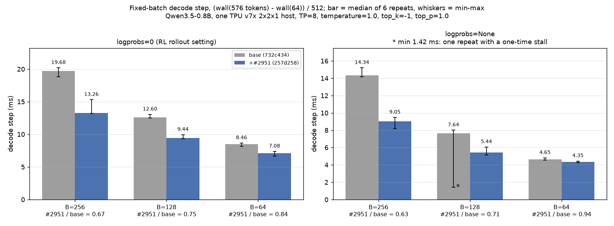
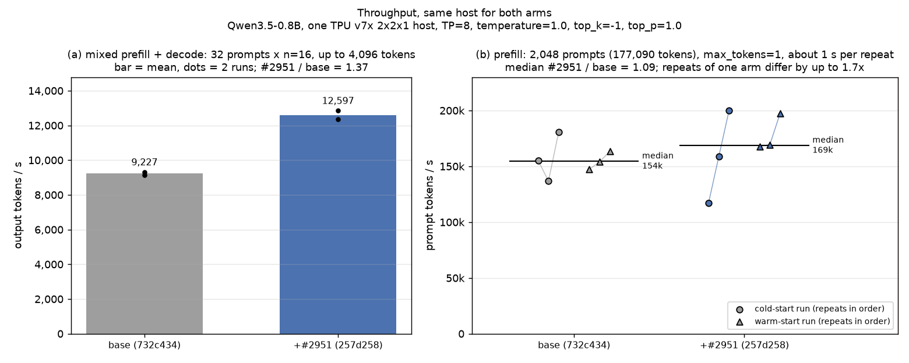
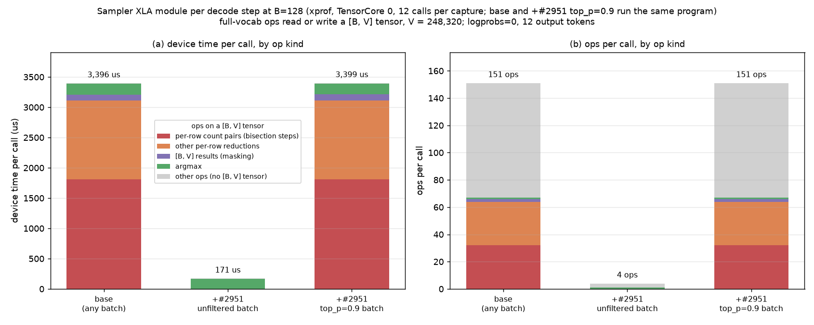
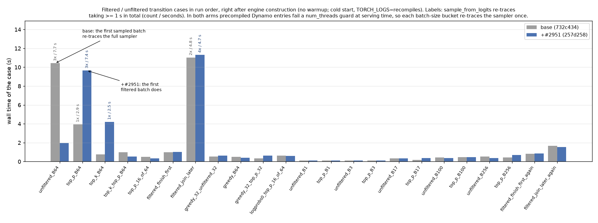

# vllm-torchtpu #2951: review and benchmark evidence

[Upstream pull request](https://github.com/vllm-project/vllm-torchtpu/pull/2951)

Reviewed head `257d258c6` against merge base `732c43464`. I support the optimization for the tested RL workload: unfiltered batches skip the identity top-k/top-p operation, while batches requiring filtering retain the existing path.

### Same-host validation (c54)

Qwen3.5-0.8B, one TPU v7x `2x2x1` host (4 chips / 8 TensorCores), TP=8, same image; only `runner/tpu_runner.py` was replaced with the file from `257d258c6`. Sampling used `temperature=1.0, top_k=-1, top_p=1.0`; throughput measurements had the profiler off.

| Measurement | Baseline | + #2951 |
|---|---:|---:|
| Decode step, B=256 / 128 / 64, `logprobs=0` | 19.68 / 12.60 / 8.46 ms | 13.26 / 9.44 / 7.08 ms |
| Decode step, B=256 / 128 / 64, `logprobs=None` | 14.34 / 7.64 / 4.65 ms | 9.05 / 5.44 / 4.35 ms |
| Prefill, `max_tokens=1` | 154k prompt tok/s | 169k prompt tok/s |
| Mixed, 32 prompts × 16 samples, cap=4,096 | 9,227 output tok/s | 12,597 output tok/s |
| Sampler module, B=128 (separate XProf capture) | 3,396 µs/call | 171 µs/call |

Decode/prefill values are medians of six measurements across two engine launches per arm, three measurements per launch. Mixed values are means of two timed repetitions within one engine launch per arm. Prefill repetitions varied by up to 1.7×; we could not resolve a stable prefill improvement beyond that variation.

*Bars: medians; whiskers: observed min–max, not confidence intervals.*

*Dots are individual timed measurements: two mixed repetitions within one engine launch per arm; six prefill repetitions across two launches per arm. They are not independent training runs.*

The B=128 sampler saves about 3.22 ms/call, consistent with the 3.16 ms decode-step reduction. Unfiltered execution drops from 67 full-vocabulary operations to one (argmax; four operations total). The `top_p=0.9` capture still uses the baseline module.

*12 calls per capture, TensorCore 0. The figure's “base (any batch)” label refers only to the two captured cases: unfiltered and `top_p=0.9`.*

### RL and exactness evidence (c53)

The earlier isolated #2951 ablation used `91552c99`, whose relevant runtime logic is unchanged in `257d258c6`. GRPO step time fell from **78.17 to 58.62 s** and generation from **68.24 to 48.79 s**: 16 trainer + 16 rollout chips, two 8-step runs per arm in reversed order, steps 4–8, validation/checkpointing off.

In a controlled in-process serving configuration (`VLLM_ENABLE_V1_MULTIPROCESSING=0`, async scheduling on), compiled TPU runs with `max_tokens=512` produced bit-identical token IDs and FP32 sampled-token logprobs for 256 sampled and 128 greedy sequences; a reseeded repeat also matched. This supports the tested workload, not production-run bitwise reproducibility or training-quality parity.

### Compilation and scope

Across three transition runs per arm, each with 23 cases, the reference worker reported ≤0.08 s of runtime XLA compilation with #2951 (baseline ≤1.5 s). All eight workers agreed on new cache-entry counts; this is not a comparison of their compile durations.

Startup measurements and first-use tracing

| Cold-cache startup stage | Baseline, r2 / r4 | + #2951, r2 / r4 |
|---|---:|---:|
| Sampler precompile | 19.44 / 20.38 s | 19.51 / 20.00 s |
| Engine construction | 133.4 / 136.7 s | 135.1 / 135.4 s |

The six additional precompile graphs produced no clearly resolved time increase in these two later cold-cache launches per arm. First launches (r1) were slower and are excluded only from this startup table: sampler precompile was 34.80 / 29.46 s and engine construction 237.0 / 178.8 s (baseline / PR). Startup timings are sensitive to launch order and run-level effects.

Both arms showed `num_threads` guard invalidation and first-use Dynamo retracing. In these runs, #2951 moved the full sampler's first-use stall from the first sampled batch to the first filtered batch. An XLA cache hit does not imply zero first-use latency.

*Bars are whole-case wall times from r4. The image's “re-traces taking … seconds” labels sum gaps from a Dynamo recompile log line to the next same-worker log line. Those gaps are coarse timing proxies, neither exclusive retracing durations nor guaranteed upper bounds. Missing labels do not imply no retracing. The arrows describe the observed first-use order in this run.*

Not covered: speculative decoding, structured output, other models/vocabulary sizes, or a serving engine using tensor parallelism across hosts.

### Integration fix when rebasing

Please add `no_top_k=True, no_top_p=True` to [`_plain_step_runner`](https://github.com/vllm-project/vllm-torchtpu/blob/b08f10fdc6166ff3aa3306629fcaf5b133012cb2/tests/runner/test_min_tokens.py#L594-L602). The random-sampling min-tokens test binds the real `_sampler_applies_topk_topp`, which now reads these fields. Please include `test_min_tokens.py` when rerunning the runner tests on the rebased head.

**Benchmark harness and method:** `bench_2951.py` (not attached here) covers the c54 same-host microbenchmarks and profiles; it does not run GRPO training or the c53 exactness checks. Decode step time is `(wall(576 tokens) − wall(64 tokens)) / 512`, with `ignore_eos=True` and one untimed warmup of each configuration. Inputs are the first 2,048 GSM8K training prompts, chat-formatted with `enable_thinking=False` and capped at 256 tokens. Fresh `VLLM_CACHE_ROOT` / `TORCHINDUCTOR_CACHE_DIR` directories are used for cold launches; r3 reuses r2's caches. Package versions: torch 2.13.0, torch_tpu 0.2.0, libtpu 0.0.50, vLLM 0.32.0.
